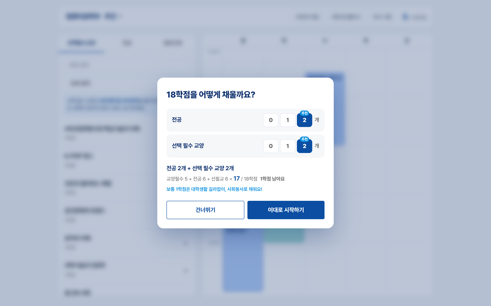
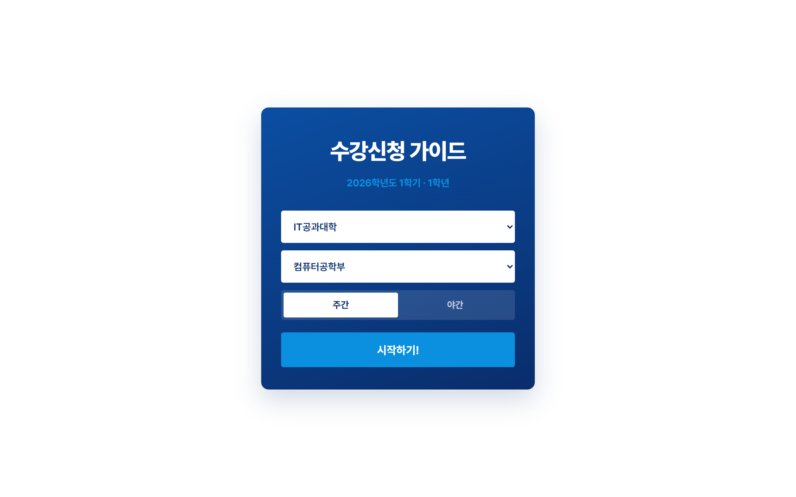
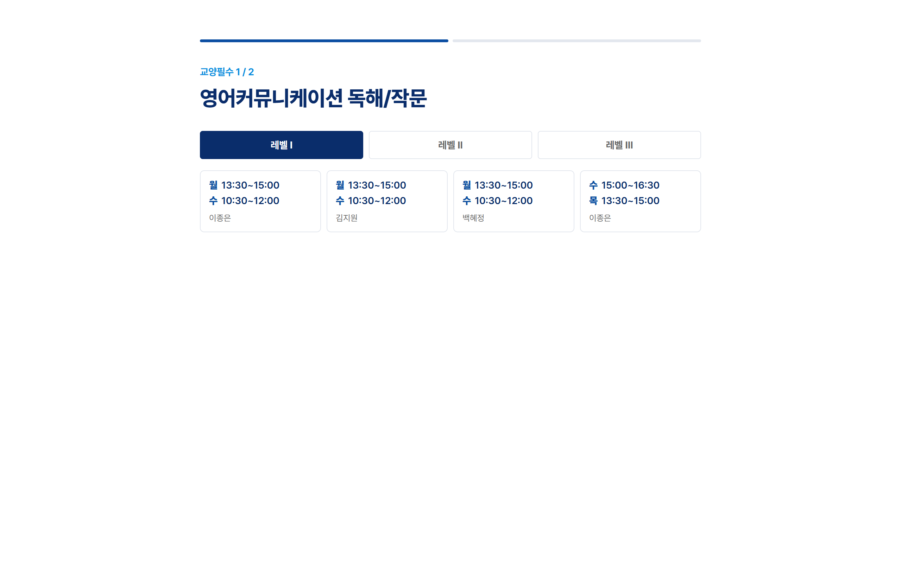
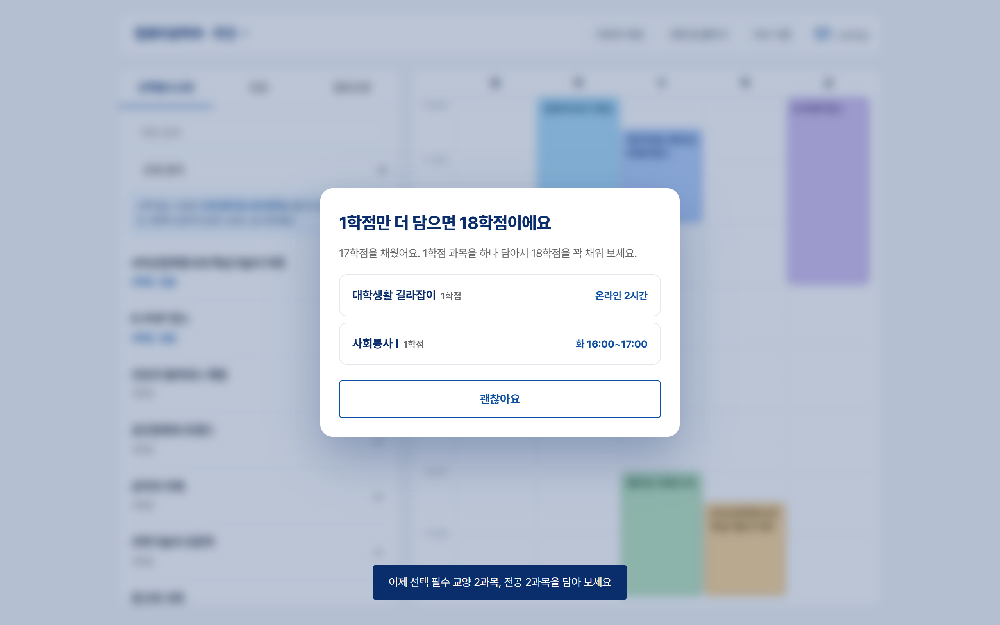
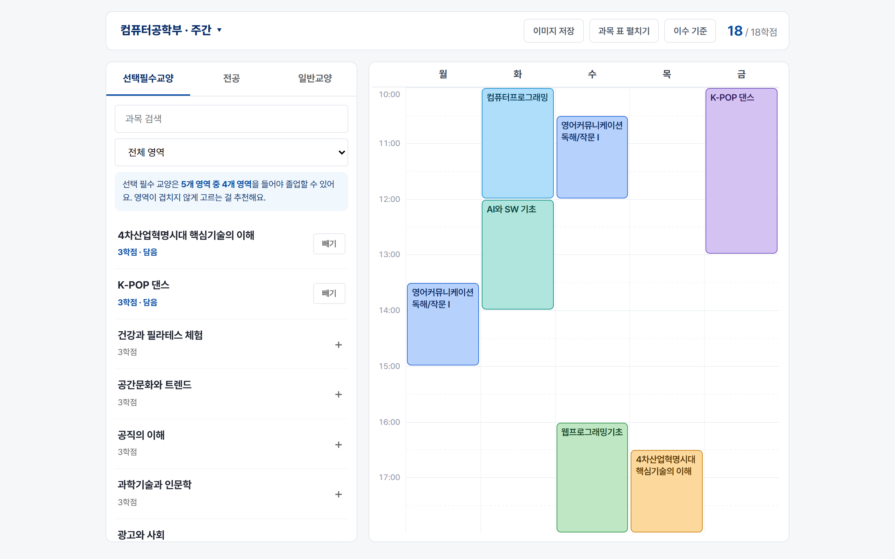
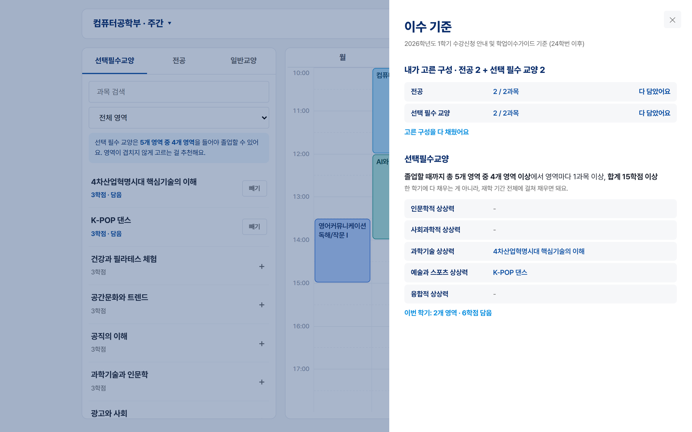

# 수강신청 가이드 · 한성대 1학년

한성대학교 신입생이 **첫 학기 시간표를 18학점까지 혼자 짤 수 있게** 도와주는 웹앱입니다.
학과를 고르면 교양필수 분반 배정부터 전공·선택필수교양 추천, 주야교차 규칙, 졸업 영역 안내까지 한 화면에서 처리합니다.

**▶ 사이트: https://vibe-rouge-five.vercel.app/**

> 고용노동부·한성대학교 대학일자리플러스센터 1:1 심화멘토링 — 바이브코딩 직무포트폴리오 · 이윤수



---

## 왜 만들었나

신입생 수강신청은 생각보다 규칙이 많습니다.

- 교양필수는 **단과대학·주야별로 배정된 분반**만 들을 수 있다
- 전공은 **주간 학생은 주간 트랙, 야간 학생은 야간 트랙**이 원칙이다
- 선택필수교양은 **5개 영역 중 4개 영역 이상, 총 15학점**을 졸업까지 채워야 한다
- 한 학기 최대 18학점, 남는 1학점은 보통 대학생활 길라잡이·사회봉사로 채운다

이 내용이 수십 쪽짜리 수강신청 안내 PDF와 강의시간표 사이트에 흩어져 있어서, 처음 보는 학생은 무엇을 몇 과목 담아야 하는지부터 막힙니다. 이 앱은 그 규칙을 코드로 옮겨, **신청할 수 있는 분반만 보여 주고 다음에 할 일을 알려 줍니다.**

## 주요 기능

| | |
|---|---|
|  | **1. 학과 선택**<br>단과대학 → 학부·학과 → 주간/야간을 고르면 그 학과 1학년에게 필요한 강의를 학교 시간표에서 실시간으로 불러옵니다. |
|  | **2. 교양필수 분반 고르기**<br>내 단과대학·주야에 배정된 분반만 보여 주고, 이미 담은 수업과 시간이 겹치는 분반은 막습니다. 영어처럼 레벨이 나뉜 과목은 레벨별로 고를 수 있습니다. |
|  | **3. 18학점 튜토리얼**<br>뒤 화면을 흐리게 하고 "전공 N개 + 선택 필수 교양 N개"를 0·1·2로 고르게 합니다. 교양필수가 2과목이면 전공 2 + 선필교 2, 3과목이면 전공 2 + 선필교 1을 추천하고, 18학점을 넘는 선택지는 비활성화합니다. |
|  | **4. 17학점 → 1학점 과목 안내**<br>시간표가 처음 17학점이 되면 대학생활 길라잡이·사회봉사 중 시간이 겹치지 않는 분반을 찾아 한 번에 담을 수 있게 안내합니다. |
|  | **5. 시간표 만들기**<br>선택필수교양(영역 필터)·전공·일반교양 탭에서 과목을 담으면 시간표에 바로 그려집니다. 같은 영역의 선필교를 또 담으면 "영역이 겹치지 않게" 알려 줍니다. 완성된 시간표와 과목 표는 이미지로 저장할 수 있습니다. |
|  | **6. 이수 기준 패널**<br>튜토리얼에서 고른 구성 대비 "전공 1/2과목 · 1과목 더 담기"처럼 남은 과목을 보여 주고, 선택필수교양 5개 영역 중 이번 학기에 채운 영역을 표시합니다. |

휴대폰에서는 강의 목록 / 시간표를 아래 탭으로 전환하는 화면으로 바뀝니다.

## 구현 방식

```
브라우저 (index.html · planner.js)
  ├─ data/departments.json  ← 학과·트랙·교양필수 배정·주야교차·수강 제한 (고정 데이터)
  └─ /api/courses?term=20261&major=V074
        └─ Vercel 서버 함수 api/courses.js → lib/school.js
              └─ 한성대 공개 강의시간표(info.hansung.ac.kr) 조회 → XML(EUC-KR) 파싱 → JSON
```

- **학과 구조와 규칙은 고정 파일** — `data/departments.json`에 2026-1 수강신청 안내·수강신청 책자 내용을 정리해 두었습니다. 단과대학 목록은 학과 데이터에서 자동으로 뽑습니다.
- **강의·시간표는 실시간** — 서버 함수가 학교 공개 시간표를 대신 조회해 과목명·학점·분반·요일·시간·강의실·교수로 정리합니다. 학교 서버 부담을 줄이려고 결과를 6시간 캐시합니다(서버 메모리 + Vercel CDN).
- **규칙 적용은 화면에서** — `planner.js`가 강의 데이터에 교양필수 분반 배정, 주야교차(내 주야 분반이 있으면 그것만, 반대쪽에만 개설된 트랙은 예외), 학년·단과대 수강 제한을 적용해 신청 가능한 분반만 보여 줍니다.
- **프레임워크 없이** HTML · CSS · 바닐라 JavaScript로 만들었고, 이미지 저장에만 html2canvas를 씁니다. 브라우저에 아무것도 저장하지 않아 들어올 때마다 새로 시작합니다.

### 파일 구성

| 파일 | 역할 |
|---|---|
| `index.html` | 화면 뼈대 (첫 화면, 교양필수 단계, 시간표, 튜토리얼, 이수 기준 패널) |
| `planner.js` | 강의 불러오기, 규칙 적용, 튜토리얼, 시간표·과목 표 그리기, 이미지 저장 |
| `planner.css` · `style.css` | 화면 스타일 (한성대 색상, 휴대폰 대응) |
| `api.js` | 브라우저 → 서버 요청 (같은 요청은 한 번만) |
| `api/courses.js` | Vercel 서버 함수: `/api/courses` |
| `lib/school.js` | 학교 강의시간표 조회·XML 파싱·시간 단위 변환·캐시 |
| `data/departments.json` | 학과·트랙·교양필수 배정·주야교차·수강 제한 데이터 |
| `vercel.json` · `package.json` | 배포 설정 |

## 바이브코딩으로 만든 과정

AI(Claude)에게 말로 요구사항을 전달하고, 실제 사이트에서 써 보며 고칠 점을 다시 요청하는 방식으로 다듬었습니다. 매 단계마다 로컬에서 동작을 확인한 뒤 배포했습니다.

1. **화면 정리** — 교양필수 다음에 나오던 '추천 구성' 단계를 없애 바로 시간표로 넘어가게 함
2. **튜토리얼 도입** — 뒤 화면을 흐리게 하고 교양필수 학점에 따라 전공·선필교 과목 수를 추천
3. **입력 방식 개선** — "전공 N개 + 선택 필수 교양 N개"를 0·1·2로 직접 고르고, 18학점 초과 선택지는 막음
4. **졸업 요건 안내** — 선필교 5개 영역 중 4개 영역 규칙을 학교 공식 교육과정 페이지와 대조해 확인한 뒤, 검색창 아래 안내문과 영역 중복 알림으로 반영
5. **1학점 과목 안내 시점 변경** — 튜토리얼에서 바로 추천하던 방식에서, 17학점을 채웠을 때 안내하는 방식으로 바꿈
6. **이수 기준 패널** — 튜토리얼에서 고른 구성 대비 더 담아야 할 과목 수 표시
7. **이미지 저장 개선** — 저장 이미지 속 과목 표 글자를 키우고 폭을 넓혀 선명하게
8. **주야교차 필터** — "주간 학생에게 저녁 7시 전공 분반이 보인다"는 문제를 발견 → 학교 수강신청 안내 PDF에서 '주간학생은 주간 트랙만' 원칙과 예외(반대쪽에만 개설된 트랙)를 찾아 규칙으로 구현하고, 전 학과에 대해 사라지는 과목이 없는지 검증

## 배포

빌드 과정이 없어서 이 폴더를 그대로 Vercel에 올리면 됩니다. 정적 파일과 `api/courses.js` 서버 함수가 함께 배포됩니다. (Vercel 계정 필요, 별도 패키지 설치 없음)

```bash
npx vercel deploy --prod
```

## 데이터 출처 · 유의사항

- 한성대학교 2026학년도 1학기 수강신청 안내 및 학업이수가이드, 수강신청 책자(강의정보)
- 한성대학교 공개 강의시간표 (시간표 및 수업계획서 조회)
- 개인 포트폴리오용 비공식 도구입니다. 실제 수강신청은 반드시 학교 종합정보시스템과 공지를 기준으로 확인하세요.
